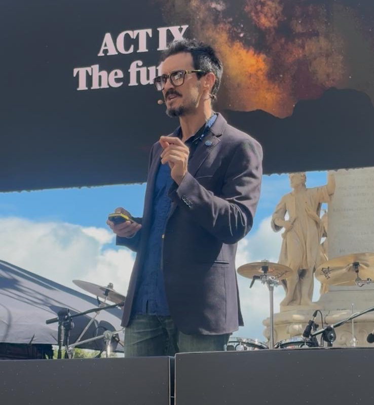

::: {.float-md-end .ms-md-3 .mb-3 style="width: 100%; max-width: 300px;"}
{fig-alt="Juan Manuel Górriz in Starmus 2026"}
:::

El catedrático de la Universidad de Granada y responsable de nuestro grupo, [Juan Manuel Górriz Sáez](/people/Juanma_Gorriz/index.qmd), participa como **ponente invitado en Starmus VIII**, el festival internacional que reúne a figuras destacadas de la ciencia, la exploración espacial, la tecnología y la cultura. La edición de este año se celebra **del 17 al 22 de octubre de 2026 en Tenerife y La Palma** bajo el lema *The Search for Truth* (*En busca de la verdad*).

## Un cartel de primer nivel

Starmus fue fundado en 2011 por el astrofísico Garik Israelian y Brian May, guitarrista de Queen y doctor en Astrofísica, y se ha convertido en un punto de encuentro singular entre ciencia, música y pensamiento. Entre los participantes anunciados para esta edición figuran los premios Nobel Geoffrey Hinton, May-Britt Moser, Donna Strickland, Michel Mayor y Serge Haroche, así como investigadores como Steven Pinker, Ignacio Cirac y Bernhard Schölkopf. El programa incluye también a astronautas y protagonistas de la exploración espacial, como Chris Hadfield y varios integrantes de la misión Artemis II de la NASA.

Para Górriz, ser seleccionado en este foro supone, en sus propias palabras, «el mayor reconocimiento que he recibido nunca». Es, además, una ocasión para proyectar internacionalmente el trabajo que se realiza en Granada en inteligencia artificial, procesamiento estadístico de señales y aplicaciones biomédicas.

## ¿Podemos fiarnos de una IA solo porque acierta?

Su intervención plantea una pregunta clave para el futuro de la inteligencia artificial: **¿podemos confiar en las conclusiones de un sistema de IA simplemente porque obtiene buenos resultados?**

En un momento en que el progreso se mide con frecuencia por el tamaño de los modelos, el volumen de datos o los porcentajes de acierto, la charla reivindica un principio esencial del método científico: la diferencia entre *obtener un resultado* y *tener evidencias suficientes para respaldar una conclusión*. A partir de ejemplos accesibles, paradojas estadísticas y casos de IA aplicada a la medicina, mostrará cómo un sistema puede lograr resultados aparentemente excelentes y, aun así, basar sus decisiones en correlaciones accidentales, características irrelevantes o patrones que no reflejan el fenómeno que se quiere estudiar.

El problema es especialmente relevante en el diagnóstico médico, donde una alta precisión estadística no garantiza que el algoritmo haya aprendido las características biológicas de una enfermedad, ni que sus predicciones sigan siendo fiables con pacientes o condiciones distintas. Por ello, la conferencia también abordará:

- La importancia de **cuantificar la incertidumbre**.
- La evaluación de la **robustez** de los modelos.
- El establecimiento de **garantías científicas** que permitan distinguir entre sistemas que simplemente funcionan bien en ciertos experimentos y aquellos cuyas conclusiones pueden considerarse realmente fiables.

## De la revolución científica a la IA

La charla conecta el desarrollo actual de la IA con uno de los grandes momentos de transformación de la humanidad: el nacimiento de la ciencia moderna. Hace unos cuatro siglos, la revolución científica cambió nuestra comprensión del mundo no solo por los nuevos instrumentos de observación, sino porque aprendimos a contrastar hipótesis, cuantificar observaciones y evaluar con rigor las evidencias. La inteligencia artificial podría protagonizar hoy una transformación de magnitud comparable, pero —sostiene Górriz— esa revolución no dependerá únicamente de modelos más grandes, más datos o más capacidad de cálculo, sino de **desarrollar una ciencia mejor**, capaz de establecer qué sabemos realmente, con qué grado de certeza y sobre qué evidencias se sostienen nuestras conclusiones.

## Investigación de Granada en el debate mundial

La participación en Starmus pone de relieve la proyección internacional de la investigación en IA y biomedicina de la Universidad de Granada. La trayectoria de Górriz —uno de los cuatro investigadores de la UGR incluidos en la lista de *Highly Cited Researchers* de Clarivate— se centra en el desarrollo de métodos estadísticos y computacionales para analizar señales e imágenes médicas, y en el estudio de las limitaciones, la incertidumbre y la fiabilidad de los sistemas de aprendizaje automático. Starmus permitirá llevar estas cuestiones desde el ámbito de la investigación especializada a un foro internacional de debate y divulgación científica.

Su participación cuenta con el apoyo de la Universidad de Granada, la Universidad de Cambridge, el Ayuntamiento de Almería, el Ayuntamiento de Granada, el Convention Bureau, el Palacio de Congresos de Granada, Cosentino, Atis y Endesa.

## Vídeos

**Starmus 2026 (1 de 2)**



**Starmus 2026 (2 de 2)**



::: {.callout-note appearance="simple"}
## Más información

- Noticia original en *Ideal*: [El catedrático de la UGR Juan Manuel Górriz participa en Starmus junto a premios Nobel y referentes mundiales de la ciencia](https://www.ideal.es/miugr/catedratico-ugr-juan-manuel-gorriz-participa-starmus-20261016133005-nt.html) (Andrea G. Parra, 16/10/2026).
:::
