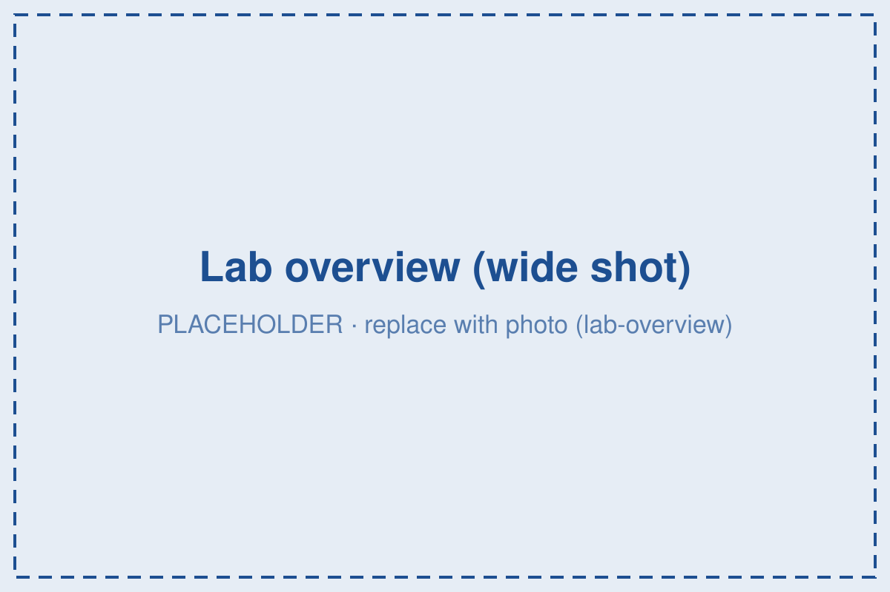
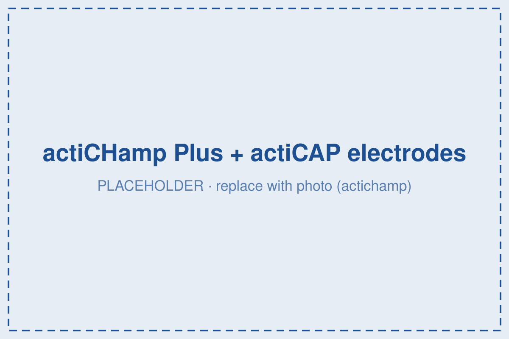
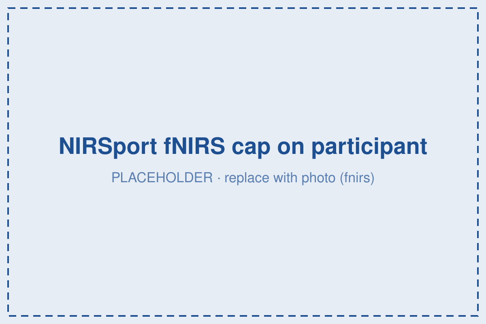
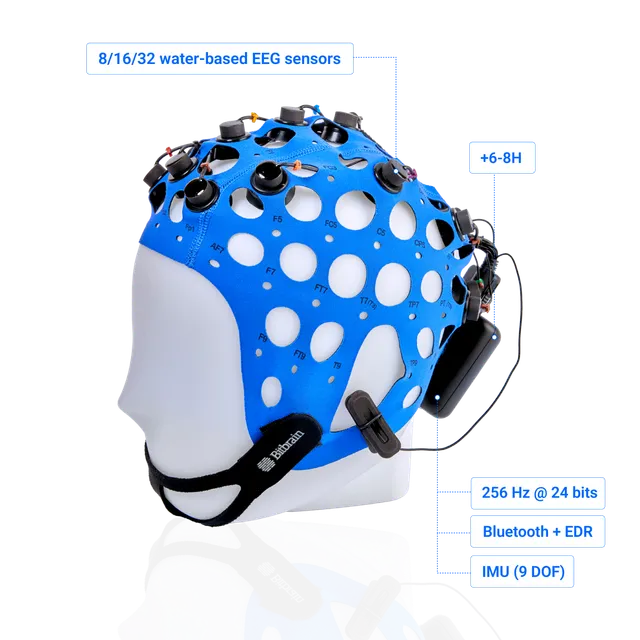
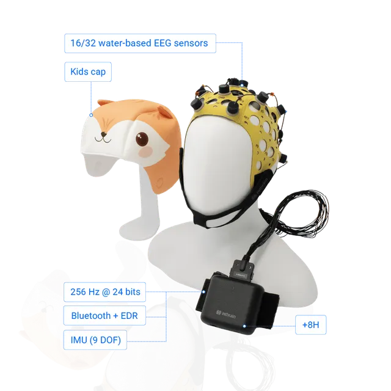
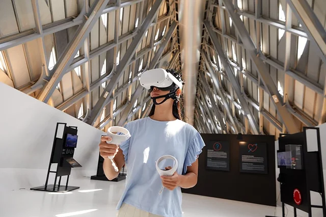
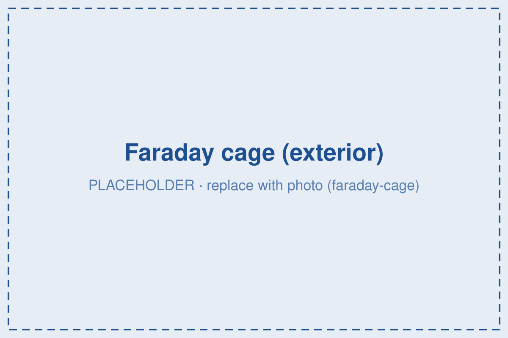
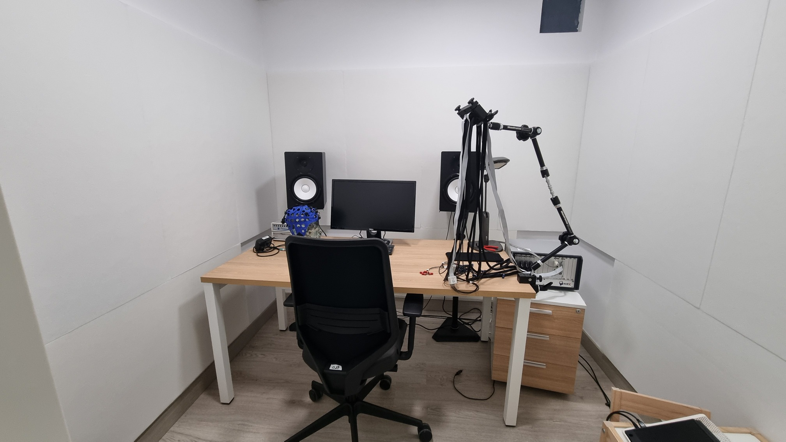
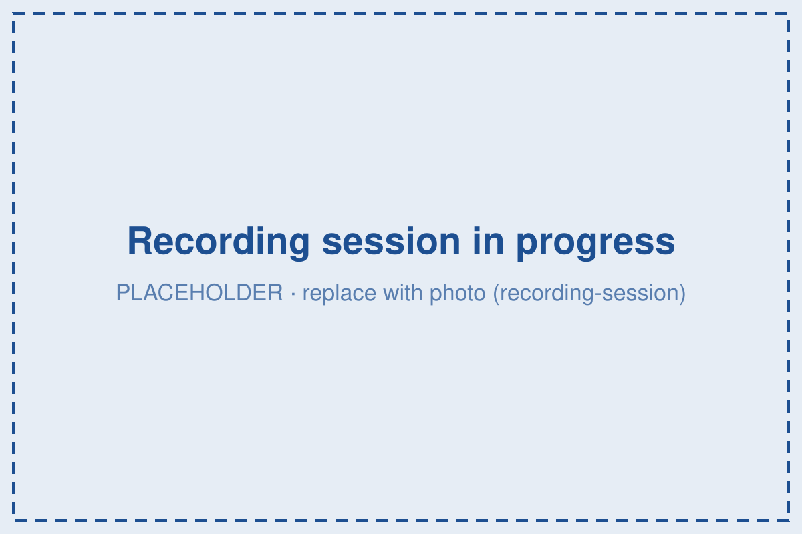

<!-- TODO: add link to the official access request form, if available. -->
<!-- IMAGES: the files in images/*.svg are placeholders. Replace each with a real photo
     (e.g. images/actichamp.jpg) and update the path below. -->

The **SigBio Lab** (Signal Processing and Biomedical Applications Laboratory) is the experimental laboratory of the [SiPBA Research Lab](../index.qmd) (TIC-218) at the University of Granada. It operates as a shared research facility that provides technical, methodological and training support in the **acquisition, processing and modelling of biomedical data** to researchers, research groups, and clinical or industrial partners.

The lab focuses on the analysis of physiological signals, their integration with imaging modalities (in particular with the upcoming low-field magnetic resonance imaging facility), and the development of advanced artificial intelligence methods.

{fig-alt="General view of the SigBio Lab" .column-page .rounded}

::: {.callout-note appearance="simple" icon=false}
 **Location:** UGR AI Building, University of Granada ([view on map](https://maps.app.goo.gl/aoqZf6dA8NGW2zvUA)).
:::

## Equipment

### High-density EEG: BrainVision actiCHamp Plus

Modular research amplifier (Brain Products) for high-density electroencephalography (EEG) and event-related potential (ERP) recordings.

- **Active electrodes** (actiCAP slim / snap) with pre-amplification at the electrode itself, reducing movement artifacts and line noise. Built-in LEDs show electrode impedance in real time.
- **Lab configuration: 32 channels.** The amplifier is modular (32-channel blocks, expandable up to 160 channels), with **24-bit** resolution and sampling rates of up to **100 kHz**.
- **Battery powered** (external PowerUnit), with galvanic isolation from the mains.
- **8 auxiliary inputs** for peripheral signals (EOG, EMG, ECG, GSR, accelerometers) and an 8-bit TTL trigger port to synchronise with stimulus presentation.

{fig-alt="actiCHamp Plus amplifier and actiCAP electrode cap" width="80%" fig-align="center"}

### Functional near-infrared spectroscopy (fNIRS)

Non-invasive optical neuroimaging system that measures the cortical haemodynamic response through changes in oxyhaemoglobin (HbO₂) and deoxyhaemoglobin (HbR) concentration.

- **NIRSport 64-channel** system (16 sources × 16 detectors).
- **Short-separation channels** to remove the superficial (scalp) vascular component.
- Being an optical technique, it neither produces nor suffers electrical interference, enabling **simultaneous hybrid fNIRS + EEG recordings**.

{fig-alt="Participant wearing the NIRSport fNIRS cap" width="80%" fig-align="center"}

### Wearable water-based EEG: Bitbrain Versatile

A new addition to the lab: three wireless, wearable Bitbrain Versatile EEG systems that give **high mobility** to participants. Recordings are no longer tied to a chair in front of a screen: participants can walk, move and interact, so studies can take place in naturalistic, ambulatory and neuroergonomics settings, inside or outside the lab.

All three systems share the same core features:

- **Hydrophilic sponge electrodes** soaked in tap water or saline instead of gel: set-up in 5–10 minutes and no residue left in the hair.
- **Wireless Bluetooth** transmission and on-board **SD card** storage, so recordings continue even away from the acquisition computer.
- Integrated **9-axis IMU** to record and compensate for head movements.

| System | Channels | Connectivity | Typical use |
|--------|:--------:|--------------|-------------|
| **Versatile EEG 8** | 8 | Bluetooth, SD card | Fast set-up, mobile and out-of-lab studies |
| **Versatile Kids 32** (baby pack) | 32 | Bluetooth, SD card | Infants and children |
| **Versatile Plus 32** | 32 | **USB**, Bluetooth, SD card | Mobile studies needing a wired link to the acquisition system |

: {.striped}

**Versatile Kids 32** is designed for studies with **infants and children**. It comes with caps in paediatric sizes and child-friendly figures that make the session more comfortable and help keep young participants engaged.

**Versatile Plus 32** adds a **USB connection** to the wireless Bluetooth and SD card options, which makes it easier to integrate with the rest of the lab set-up when a wired link is preferred.

::: {layout-ncol=2}
{fig-alt="Bitbrain Versatile EEG headsets"}

{fig-alt="Child-size Bitbrain Versatile Kids cap with figures"}
:::

{fig-alt="Participant walking while wearing a Bitbrain Versatile EEG headset" width="80%" fig-align="center"}

### Acoustically conditioned Faraday cage

Shielded enclosure that isolates recordings from mains noise (50 Hz and harmonics) and radio-frequency interference (Wi-Fi, mobile phones, Bluetooth). It is essential for very low-amplitude signals such as EEG (in the 1–100 µV range), high-frequency bands (gamma, > 30 Hz) or auditory brainstem responses.

The cage is **fully acoustically conditioned** and equipped for studio-quality presentation of **music and speech stimuli**:

- 16 acoustic absorption panels (1.2 × 0.6 m).
- 2 Yamaha HS8 studio monitors on Gravity SP3202 stands.
- Marani MIR 260E audio processor.

::: {layout-ncol=2}
{fig-alt="Exterior of the Faraday cage"}

{fig-alt="Acoustic absorption panels and Yamaha HS8 monitors inside the cage"}
:::

This makes it particularly well suited to studies of auditory perception, music and language, such as those in the [ML2BRAIN](../research/projects/2025-04-01-project-ml2brain/index.qmd) project.

### Other sensors and computing

- Additional **biomedical sensors**: ECG, EMG, EOG, pressure, temperature, oxygen saturation, etc.
- **High-performance computing:** UGR parallel computing servers and the group's own GPU cluster (SiPBA3).
- **Specialised software:** MATLAB, Python, EEGLAB, FSL, SPM, FreeSurfer, among others.

## Services

| Area | Services |
|------|----------|
| **Signal acquisition** | EEG, ECG, EMG, EOG and fNIRS recordings; design and execution of experimental protocols with a specialist technician. |
| **Processing and analysis** | Filtering and artifact removal, spectral analysis, functional and structural connectivity, image reconstruction and multimodal fusion (EEG-fMRI, fNIRS-MRI), machine learning and advanced statistics. |
| **Computing** | Access to the HPC/GPU infrastructure and the lab's specialised software. |
| **Consulting** | Methodological advice and experimental design. |
| **Training and transfer** | Workshops, hands-on courses and advice to companies. |

## Collaboration and access to facilities

The SigBio Lab is open to external researchers and organisations in two ways:

**Scientific collaboration.** If your project fits the group's [research lines](../research.qmd) (neuroimaging and electrophysiology, computer-aided diagnosis, machine learning and explainable AI in medicine), we are happy to discuss a collaboration: joint projects, research stays, thesis co-supervision or joint publications. In this case, use of the lab is agreed within the collaboration.

**Service provision.** Research groups, public bodies and companies can book the equipment and technical staff at the public rates listed below.

{fig-alt="Researcher preparing a participant for an EEG recording" width="80%" fig-align="center"}

### How to request access

1. **Get in touch** at [sipba@ugr.es](mailto:sipba@ugr.es) with a short description of the study, the type of recording and the planned dates.
2. **Submit an official request** through the lab's request form or the UGR Shared Services Office (Oficina de Servicios Comunes).
3. **Technical assessment and scheduling** together with the lab staff.
4. **Sign the responsible-use agreement** before recordings start.

## Public rates 2025

| Code | Service | Price (€) |
|:----:|---------|----------:|
| 1 | Specialist technician (per hour) | 120 |
| 2 | Signal acquisition (EEG, ECG, EMG, fNIRS) with technician | 180 |
| 3 | Biomedical data processing and analysis | 150 |
| 4 | Use of HPC/GPU infrastructure (per hour) | 100 |
| 5 | Methodological advice and experimental design | 120 |
| 6 | Personalised training (per session) | 100 |
| 7 | Data storage and management (per project) | 80 |

: Indicative rates for 2025. Prices exclude VAT. {.striped .hover}

**Discounts by user type:**

| User type | Discount |
|-----------|:--------:|
| University of Granada (UGR) | 70% |
| Public Research Organisations (OPIs) | 50% |
| Private entities | No discount |

: {.striped}

::: {.callout-tip appearance="simple"}
Not sure which service you need, or would like a quote tailored to your study? Write to us at [sipba@ugr.es](mailto:sipba@ugr.es).
:::

## Contact

 [sipba@ugr.es](mailto:sipba@ugr.es) 
 [UGR AI Building, Granada](https://maps.app.goo.gl/aoqZf6dA8NGW2zvUA)
