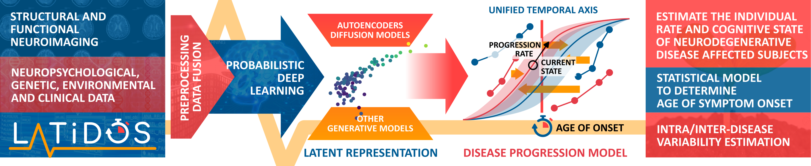
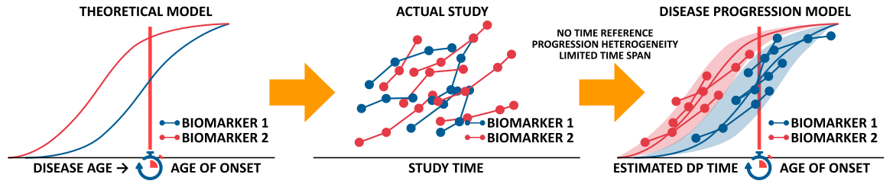

**LATiDOS** is a proposal oriented to solve a particular problem: to create data-driven models of the progression of neurodegeneration and use them to determine the individual age of symptom onset.

```{=html}
<!--[ Documentation](http://mapbrain.readthedocs.io/en/latest/quickstart.html){.btn .btn-outline-primary .btn role="button" data-toggle="tooltip" title="Read the documentation"}
[ Download](https://github.com/SiPBA/mapBrain){.btn .btn-primary .btn role="button" data-toggle="tooltip" title="Download the package"}-->
```
# The project

Research has recently shown that the neuropathological processes of neurodegenerative diseases (NDDs) begin years or even decades before symptoms appear. There are several initiatives worldwide that study the progression of subjects at risk of developing these diseases, some even from a very early age, and that collect a wide variety of longitudinal data such as symptomatology, biochemical markers or neuroimaging. This would provide insight into pathological processes long before their "conversion", or the appearance of the first symptoms.

This proposal aims to combine neuroimaging, biochemical, genetic, neuropsychological and epidemiological data using data fusion and machine learning strategies to study and model the progression of NDDs and predict the individual age of symptom onset. This will be done using feature extraction and fusion methodologies using mainly latent variable models based on deep neural networks. The latent information can be combined with other associated genetic and biochemical data as well as different environmental factors to generate a series of models of NDD progression. Different individual and ensemble models of progression will be proposed, which will be validated qualitatively and quantitatively by experts in statistics and neurology, as well as by assessing their generalisability to other existing databases. On the one hand, it is hoped to obtain a better understanding of the processes of neurodegeneration that will make it possible to characterise the degree of individual affectation at a specific time and how different biological, biochemical and environmental variables affect the speed of progression of the disease. It is also hoped to obtain a computational model to predict the age of symptom onset in individual patients from the above data. On the other hand, significant advances are expected to be made in the study of current deep learning methods applied to medical imaging and data fusion, favouring the paradigm of interpretable machine learning.



# Objectives

LATiDOS has one **general objective: to build and evaluate data-driven models of the progression of neurodegenerative diseases**. These models should be able to determine the individual disease state and progression rate, as well as determining the Age of Symptom Onset (ASO), accounting for variability due to sex, age, etc. This can be realized by achieving the following **specific objectives**:

1.  **Download, merge and organize a large dataset of NDDs patient data, including medical history, neuroimaging and biomarkers**. Modalities include PET-PIB, PET-FDG functional images and Magnetic Resonance Imaging (MRI) -structural and functional-, as well as epidemiological, genetic, biochemical and population data that can help in NDD stratification.
2.  **Obtain an accurate and generalizable latent representation of each NDD data cohort with maximum clinical validity**. Specific probabilistic neural architectures for manifold learning will be used for this process.
3.  **To derive causal and non-causal model(s) of DP at different levels of accuracy that primarily use neuroimaging-driven latent variables, but also take into account clinical, environmental and genetic background**. Use them to accurately redefine ASO.
4.  **Test and validate the developed models using a diverse set of patients and compare their performance to existing models. Ensure that the DPMs are interpretable by expert neurologists** at different levels of accuracy.
5.  **Explore the potential for using these models to identify new biomarkers and drug targets for neurodegenerative diseases.**
6.  **Investigate and communicate the use of these models in clinical settings, such as for early diagnosis and treatment planning**. Effective communication of the methodology and results of the project to the scientific community, specialized audience (clinical staff, policymakers, as well as affected subjects and their environment) and the public.

# Results

The project concluded on 31 August 2026. Over its three years, LATiDOS has produced the following results:

## Publications

### Latent variable models and data fusion
-   We published a paper in the *International Journal of Neural Systems* about a [cross-modality latent variable framework using joint Variational Autoencoders](/publications/2024-05-10-bridging/index.qmd) that bridges imaging and clinical scores in Parkinson's disease progression, by @martinez2024bridging.
-   Siamese autoencoders were used to transfer information between imaging modalities in an explainable way, published in *IEEE Transactions on Radiation and Plasma Medical Sciences* by @arco2025explainable.
-   A critical analysis of how latent space projections and brain atlases are used in deep neuroimaging with autoencoders, *Latent Space Projections and Atlases, a Cautionary Tale in Deep Neuroimaging using Autoencoders*, was published in the *International Journal of Neural Systems* by @gorriz2026latent.

### Validation of machine learning models
-   A novel framework to evaluate regression performance, called Statistical Agnostic Regression (SAR) by @gorriz2024statistical.
-   SAR was later applied to assess the robustness of clinical and metabolic activity models in the PPMI cohort [@hernandez2026assessing].

### Parkinsonism and real-world clinical data
-   Following the release of the PDBIGDATA database [@lopez2024pdbigdata], we published a semi-automated pipeline for extracting and analysing Parkinson's imaging data from routine clinical practice in the *European Journal of Medical Research* by @lopez2026bridging.

### Frontotemporal dementia (GENFI)
-   We published a novel paper within the [GENFI](https://www.genfi.org) initiative, in collaboration with the team at the LMU University in Munich, entitled *Frequency and Longitudinal Course of Behavioral and Neuropsychiatric Symptoms in Participants with Genetic Frontotemporal Dementia* by @schonecker2024frequency.
-   The collaboration continued with a study in *Neurology* on the *Patterns and trajectories of behavioral and neuropsychiatric symptoms in frontotemporal dementia and primary progressive aphasia* by @marth2026patterns.

### Alzheimer's disease in Down syndrome (DZNE)
-   We collaborated with the Deutsche Zentrum für Neurodegenerative Erkrankungen (DZNE) in an analysis published in the *Alzheimer's & Dementia* journal about the exploratory analysis of the proteomic profile in plasma in adults with Down syndrome in the context of Alzheimer's Disease by @wagemann2025exploratory. These novel biomarkers could be used to stratify patients into different groups and predict the disease progression.
-   A follow-up study in *Neurology* characterised the *Longitudinal Dynamics of the Blood Proteome Within the Alzheimer Spectrum in Down Syndrome* [@wagemann2026longitudinal], moving these biomarkers towards modelling disease progression over time.

### Related methodology
The methods developed in LATiDOS (latent representations, small-sample validation and explainable deep learning) have also been applied and extended in related problems:

-   Novel measures for machine learning in small-sample neuroimaging studies, applied to schizophrenia, published in *Human Brain Mapping* by @jimenez2024machine.
-   Data- and model-driven permutation testing approaches to unravel the heterogeneity of the autism spectrum in the ABIDE I database [@alcaide2026unraveling].
-   AI-driven discovery of neuroimaging biomarkers of brain tumour surgery [@jimenez2025uncovering], and the link between radiomic signatures and PCA/UMAP manifold representations of the brain in glioma, presented at IWINAC 2026 [@jimenez2026regions].
-   *DualFlexKAN*, a dual-stage Kolmogorov-Arnold Network architecture with independent function control [@ortiz2026dualflexkan].
-   Improved organs-at-risk segmentation using a modified U-Net with self-attention and consistency regularisation, published in *CAAI Transactions on Intelligence Technology* by @manko2024improved.

### IWINAC 2024
We presented a series of publications at the *International Work-Conference on the Interplay Between Natural and Artificial Computation* (IWINAC 2024):

-   *A Cross-Modality Latent Representation for the Prediction of Clinical Symptomatology in Parkinson's Disease* by @vazquez2024cross
-   *PDBIGDATA: A New Database for Parkinsonism Research Focused on Large Models* by @lopez2024pdbigdata
-   *A Comparative Study of Deep Learning Approaches for Cognitive Impairment Diagnosis Based on the Clock-Drawing Test* by @jimenez2024comparative

### IWINAC 2026
At IWINAC 2026 we presented the core disease progression and Age of Symptom Onset (ASO) models of the project:

-   *Survival Modeling in the Latent Space for Alzheimer's Prognosis* by @martinez2026survival, which combines the latent representations learnt in the project with survival analysis to estimate time to conversion.
-   *Longitudinal Modeling of Alzheimer's Disease Progression Using a Bayesian Latent Framework with APOE-Dependent Genetic Effects* by @vazquez2026longitudinal, a disease progression model that accounts for genetic background.
-   *Modeling and Predicting Age-at-Onset Trajectories in Genetic Frontotemporal Dementia Using Survival Methods* by @arco2026modeling, in collaboration with GENFI and LMU Munich, directly addressing the prediction of individual age of symptom onset.
-   *Assessing the Robustness of Clinical--Metabolic Activity Models Through SAR in the PPMI Dataset* by @hernandez2026assessing.

## Talks
-   IWINAC 2024: [Cross-Modality Latent Variable Framework for the Prediction of Clinical Symptomatology in Parkinson's Disease]
-   IWINAC 2024: [PDBIGDATA: A New Database for Parkinsonism Research Focused on Large Models]
-   IWINAC 2026 (oral): Survival Modeling in the Latent Space for Alzheimer's Prognosis
-   IWINAC 2026 (oral): Longitudinal Modeling of Alzheimer's Disease Progression Using a Bayesian Latent Framework with APOE-Dependent Genetic Effects
-   IWINAC 2026 (oral): Modeling and Predicting Age-at-Onset Trajectories in Genetic Frontotemporal Dementia Using Survival Methods
-   IWINAC 2026 (oral): Assessing the Robustness of Clinical--Metabolic Activity Models Through SAR in the PPMI Dataset
-   *Actividad*: Música e IA at the European Researcher's Night 2024 (27/09/2024)
-   *Taller*: ¡Las máquinas nos quitan el trabajo! (14/03/2024), en el proyecto *Mujer y Niña en la Ciencia* de la Unidad de Cultura Científica de la Universidad de Granada.

## Software
-   We released the [PDBIGDATA](https://github.com/PDBIGDATA/PDBIGDATA) database, a new database for Parkinsonism Research focused on Large Models [@lopez2024pdbigdata].

## References

::: {#refs}
:::

# Funding 
This project PID2022-137629OA-I00 is funded by MICIU/AEI/10.13039/501100011033 and by ERDF/EU (European Regional Development Fund).

