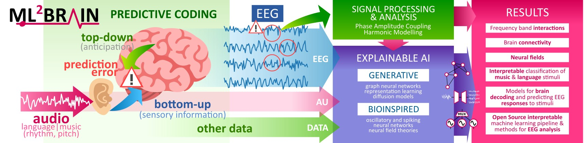
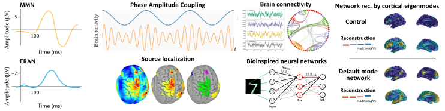
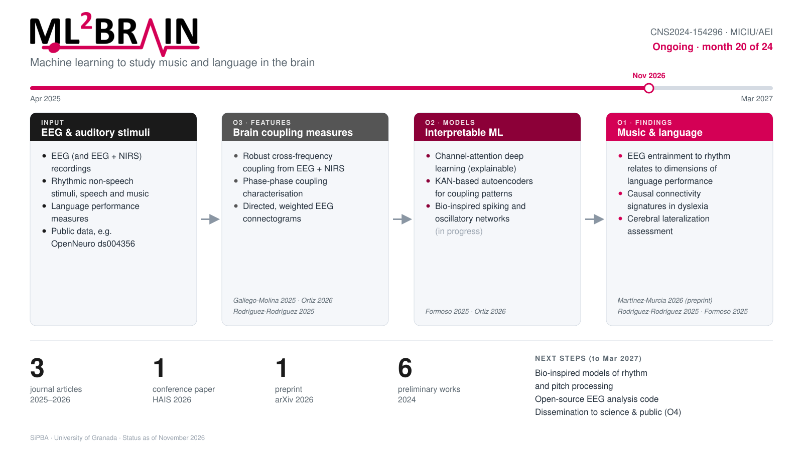

**ML2BRAIN** is a project aimed at investigating the complex interplay between music and language perception in the human brain.

```{=html}
<!--[ Documentation](http://mapbrain.readthedocs.io/en/latest/quickstart.html){.btn .btn-outline-primary .btn role="button" data-toggle="tooltip" title="Read the documentation"}
[ Download](https://github.com/SiPBA/mapBrain){.btn .btn-primary .btn role="button" data-toggle="tooltip" title="Download the package"}-->
```

# The project
The **ML2BRAIN** project aims to investigate the complex interplay between music and language perception in the human brain. Using EEG as the primary technique, research will seek to overcome the limitations of traditional EEG analysis by combining innovative methods, including explicable machine learning and bio-inspired models, to provide new insights into how the brain responds to auditory stimuli in music and language. The objectives of the study include investigating brain patterns associated with language and music processing, developing interpretable machine learning algorithms for EEG data analysis, evaluating and improving feature extraction methods, and communicating the results to the scientific community and the public. In particular, traditional and advanced EEG feature extraction methods will be evaluated, including recent cross-frequency coupling measurements and models based on neural field theory. Both generative artificial intelligence and bio-inspired models will be used to address the challenges of EEG signal processing and analysis. Generative AI will be used to build data-driven representations of the latent spaces underlying EEG data, as well as for brain decoding of stimulus parameters and/or signals. Bio-inspired algorithms such as spiking and oscillatory neural networks will be trained to model the brain's behaviour under language and music stimuli. In all these cases, interpretability will be key, as Explainable Artificial Intelligence (XAI) should be at the heart of any science-based research.

The expected outcomes of the ML2BRAIN project are twofold. First, the research will reveal specific brain patterns, activations and oscillatory dynamics associated with language and music processing. Second, the interpretable machine learning and bio-inspired algorithms developed are expected to provide accurate predictions of rhythm and pitch variables from EEG data, thus providing a deeper understanding of the neural processes involved in auditory perception. The potential impact of the project is significant, contributing to the advancement of neuroscience research, the open-source accessibility of advanced EEG analysis techniques, and a better understanding of brain processing in language and music. The impact of the research extends beyond neuroscience, encouraging interdisciplinary collaboration between neuroscience researchers and machine learning experts. The project's open source code and implementations will make advanced EEG analysis techniques available to researchers worldwide, facilitating their adoption in diverse research settings. The interdisciplinary nature of the project will strengthen and diversify the research activities of the host institution and foster collaborations with leading international research groups.



# Objectives

ML2BRAIN has one general objective: **to develop new machine learning techniques for EEG analysis that facilitate the understanding of how the brain perceives language and music**. This can be realized by achieving the following specific objectives:

1. To study specific **patterns**, **activations**, and **oscillatory dynamics** that are indicative of the brain's processing of language and music. This will be mainly based in the analysis of already acquired data (e.g. OpenNeuro ds004356) as well as collecting EEG data from participants performing different language and music tasks for validation.
2. To develop and refine **interpretable ML and bioinspired algorithms for EEG analysis** to predict variables/timeseries of interest (rhythm, pitch) at the group and subject level. 
3. To evaluate and improve state-of-the-art **feature extraction methods for EEG**, including PAC, NFTs, etc., and compare these to traditional EEG features (ERP, power spectrum…).
4. To **communicate** the methods and results to the scientific community, specialized audience and the public. Additionally, to identify potential uses of the developed methodology and findings in other domains.

# Results



## Publications

### Neural entrainment to rhythm and language
-   We analysed how the brain synchronises to non-speech rhythmic patterns and how this entrainment relates to language skills. The preprint *EEG Entrainment to Non-Speech Rhythmic Patterns Associated with Dimensions of Language Performance* by @martinez2026eeg shows that EEG entrainment to rhythmic auditory stimuli is associated with different dimensions of language performance, supporting a shared neural basis for rhythm processing in music and language.
-   Directed, weighted EEG connectograms were used to characterise one-to-one causal interactions between brain regions in developmental dyslexia, published in the *International Journal of Neural Systems* by @rodriguez2025directed.
-   An explainable deep learning approach with a channel attention mechanism was proposed to assess cerebral lateralization, published in the *IEEE Journal of Biomedical and Health Informatics* by @formoso2025cerebral.

### Cross-frequency coupling and EEG feature extraction
-   We proposed a multimodal integration of EEG and near-infrared spectroscopy (NIRS) for a robust estimation of cross-frequency coupling, published in the *International Journal of Neural Systems* by @gallego2025multimodal.
-   At the *International Conference on Hybrid Artificial Intelligent Systems* (HAIS 2026), we presented the characterization and classification of phase-phase coupling using a Kolmogorov-Arnold Network (KAN) based autoencoder [@ortiz2026phase].

### Preliminary work
The project builds on previous work of the group on EEG synchronisation, phase-amplitude coupling and speech rhythm, mostly presented at IWINAC 2024 and in journal publications prior to the start of ML2BRAIN:

-   A survey on EEG phase-amplitude coupling to speech rhythm for the prediction of dyslexia [@gallego2024survey].
-   An explainable representation of phase-amplitude coupling to visualize brain synchronization [@ortiz2024visualizing].
-   Neuronal coupling estimation enhanced by NIRS/EEG integration [@gallego2024enhancing].
-   Causal mechanisms of dyslexia via connectogram modeling of phase synchrony [@rodriguez2024causal].
-   The interplay between heart rate variability features and EEG local connectivity patterns in dyslexia [@formoso2024explainable].
-   Explainable neural networks to unravel brain synchronisation dynamics from EEG signals, published in *Interdisciplinary Sciences: Computational Life Sciences* by @gallego2024unraveling.

<!--
## Talks
-

## Software
-   
-->

## References

::: {#refs}
:::

# Funding

This project CNS2024-154296 is funded by MICIU/AEI/10.13039/501100011033.

